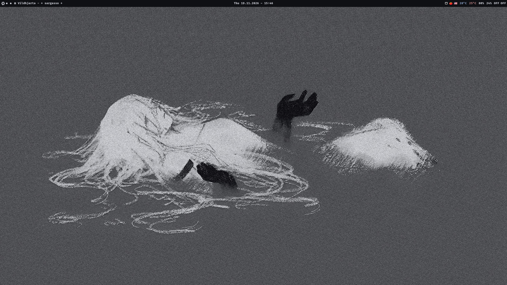
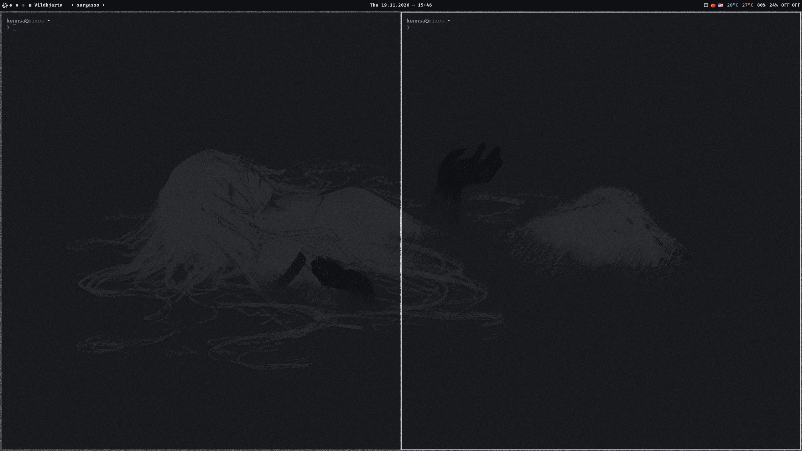

# NixOS Configuration

A personal, highly modular, and declarative NixOS configuration using **Flakes**, **Home Manager**, and **Stylix**. This setup is designed for a seamless desktop experience with a focus on DevOps workflows, gaming, audio production, and game streaming.

## Screenshots


*Desktop + Waybar*


*Niri + Kitty*


*Wlogout*

## Hosts

The configuration currently manages two machines via the `lib/mkHost.nix` factory:

*   **`desktop`**: The primary desktop workstation.
    *   *Features*: Full gaming setup, streaming (OBS, Sunshine), audio production (Carla/Reaper), and heavy DevOps tooling.
*   **`laptop`**: A lightweight laptop setup.
    *   *Features*: Core essentials, but excludes heavy desktop-specific modules like OBS, Reaper, Wine, and Sunshine.
*   **`console`** *(Planned)*: A dedicated living room console build.
    *   *Features*: Built on **Jovian-NixOS** for a Steam Machine-like experience. Boots directly into Steam Big Picture with Gamescope. Includes Niri as a desktop fallback, plus a minimal set of tools.

## Repository Structure

The repository follows a strict separation of concerns between system-level (NixOS) and user-level (Home Manager) configurations.

### Core Structure
*   `flake.nix`: The entry point. Defines inputs (`nixpkgs-unstable`, `nixos-26.05` fallback, `home-manager`, `stylix`, `sops-nix`, `disko`) and outputs.
*   `lib/mkHost.nix`: A custom function to generate host configurations, passing down `inputs`, `username`, `disks`, and `hostName` via `specialArgs`.
*   `hosts/`: Host-specific configurations.
*   `overlays/`: Custom overlays (e.g., `stable.nix` to provide packages from the `nixos-26.05` channel for the unstable system).
*   `screenshots`: Images used in this README.
*   `secrets/`: Encrypted secrets (`secrets.yaml`) managed by `sops-nix`.

### NixOS Modules (`modules/nixos/`)
*   **`app/`**: System-wide GUI applications (`carla-yabridge`, `docker`, `nautilus`, `steam`, `virt-manager`, `wine`).
*   **`core/`**: Base system configuration (`boot`, `kernel`, `nix`, `zsh`, `swap`, `tmpfiles`, and the `chattr-nocow` service).
*   **`desktop/`**: Desktop environment and compositor setup (`niri`, `uwsm`, `stylix`, `fonts`, `codec`, `getty`).
*   **`hardware/`**: Hardware-specific tweaks (`audio`, `bluetooth`, `cpu`, `gpu`, `logind`, `power`).
*   **`network/`**: Networking and connectivity (`tailscale`, `ssh`, `fail2ban`, `zapret`).
*   **`security/`**: System security modules (`sops`, `hyprlock-pam`).
*   **`service/`**: Background services and daemons (`restic`, `restic-dir`, `sunshine`, `sunshine-stream`, `polkit-agent`, `wireplumber-disable-hdmi-dp`, `tg-ws-proxy`).
*   **`user/`**: User account definition and Home Manager integration.

### Home Manager Modules (`modules/home/`)
*   **`backup/`**: `rsync` configuration.
*   **`browser/`**: `firefox` setup.
*   **`cli/`**: Command-line tools (`btop`, `diskwatch`, `fastfetch`, `neovim`, `yazi`).
*   **`desktop/`**: User-level desktop apps and configs (`fuzzel`, `waybar`, `mako`, `hyprlock`, `hypridle`, `wlogout`, `swaybg`, `tomat`, `gtk`, `qt`, `nautilus`, `niri`, `wl-clip-persist`).
*   **`device/`**: Device-specific tools (`ios`).
*   **`devops/`**: DevOps tooling (`ansible`, `terraform`, `kubernetes`, `docker`, `gh`, `glab`, `git`, `go`, `python`, `vscode`, `lazydocker`, `lazygit`, `mosh`, `trivy`, `json-yaml`, `just`, `lint`).
*   **`document/`**: Document viewers and editors (`calculator`, `libreoffice`, `obsidian`, `zathura`).
*   **`gaming/`**: Gaming tools (`mangohud`, `mesa`, `obs`, `pince`, `qbittorrent`).
*   **`guitar/`**: Audio production (`reaper`).
*   **`media/`**: Media players and tools (`coppwr`, `foliate`, `imv`, `kid3`, `mpd`, `mpv`, `rmpc`).
*   **`messenger/`**: Communication apps (`telegram`, `webcord`).
*   **`security/`**: User-level security (`gnupg`, `keepassxc`).
*   **`shell/`**: Shell environment (`zsh`, `kitty`, `fzf`, `starship`, `tmux`, `zoxide`, `direnv`).
*   **`system/`**: XDG directories, mime-types, and XWayland.
*   **`windows/`**: Wine configuration.

## Just

This configuration uses a `justfile` to simplify common tasks.

```bash
# Update flake inputs, build for next boot, and push to Git
just update

# Build the configuration for the next boot
just boot

# Apply the configuration immediately
just switch

# Run garbage collection (keeps 3 generations)
just gc

# Check flake eval
just check
```
